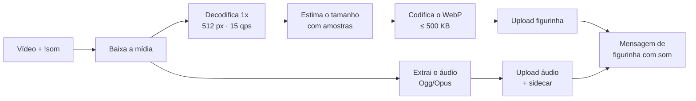

<p align="center">
  
</p>

<h1 align="center">Figurinhas com som para WhatsApp 🔊</h1>

<p align="center">
  <b>Bot de WhatsApp que transforma qualquer vídeo em figurinha animada com som.</b><br>
  Mande um vídeo com <code>!som</code> e receba de volta uma figurinha que toca o áudio.<br>
  <i>WhatsApp sound sticker bot: turn any video into an animated sticker with audio. <a href="#english">English below</a>.</i>
</p>

<p align="center">
  <a href="https://github.com/coelhobugado/whatsapp-figurinhas-com-som/actions/workflows/test.yml"></a>
  <a href="LICENSE"></a>
  
  
  
</p>

---

## O que é

O WhatsApp tem **figurinhas com som** (figurinhas animadas que tocam áudio), mas não deixa você criar a sua a partir de um vídeo. Este bot cria:

```
você:  [vídeo do seu gato miando]  !som
bot:   ⏳ … 🔊  [figurinha animada do gato, miando]
```

Ele roda no seu computador ou servidor, conectado a um número de WhatsApp como um "aparelho conectado". Qualquer pessoa (ou só quem você liberar) manda um vídeo para esse número e recebe a figurinha com áudio de volta, no privado ou em grupos.

## Recursos

- 🔊 **Figurinha com som**: a partir de vídeo de celular, GIF ou vídeo mandado como documento.
- ⚡ **Rápido**: ~3–8 s por figurinha, mesmo com vídeo 1080p pesado ([veja como](#como-ficou-rápido)).
- 🖼️ **Sem bordas pretas**: preenche o quadrado 512×512 cortando o centro, ou `inteiro` para manter a imagem toda com fundo transparente.
- 🏷️ **Nome do pacote personalizado** ("Criada por …") gravado na figurinha.
- 🛟 **Nunca deixa ninguém sem resposta**: se o som falhar, manda a versão sem som e explica o motivo (vídeo sem áudio, áudio mudo, recusa do WhatsApp…).
- 🧵 **Fila justa**: um pedido por pessoa de cada vez, posição na fila e limite de tempo por pedido.
- 🔒 **Privado**: nenhum vídeo passa por serviço de terceiros; links são baixados direto da plataforma e a conversão é local, com FFmpeg.
- 🙂 Também faz figurinhas comuns (sem som) de foto, vídeo e GIF.

## Comandos

| Comando | O que faz |
|---|---|
| `!som` (ou `!fs`) | Figurinha animada **com som**. Mande o vídeo com essa legenda ou responda a um vídeo com `!som`. |
| `!fig` (ou `!f`, `!s`) | Figurinha comum, sem som, de foto, vídeo ou GIF. |
| `!ajuda` | Lista os comandos. |

- **Link no lugar do vídeo**: `!som <link>` e `!fig <link>` aceitam links de TikTok, Instagram e YouTube (ou responda a uma mensagem com o link). Vídeos grandes têm só os primeiros 10 s baixados.
- `!som inteiro` / `!fig inteiro`: mantém a imagem toda (bordas transparentes) em vez de cortar.
- Reações do bot: ⏳ processando · 🔊 saiu com som · ✅ saiu sem som · ❌ erro.
- Limites: usa os primeiros **10 segundos** do vídeo; arquivo de até **16 MB**.

## Instalação

**Requisitos**

- [Node.js](https://nodejs.org) 22.12 ou mais novo
- [FFmpeg](https://ffmpeg.org) e ffprobe no PATH, com `libwebp`, `libopus` e `libx264` (o bot confere ao iniciar):
  - **Windows**: `winget install Gyan.FFmpeg` (ou o build "full" do [gyan.dev](https://www.gyan.dev/ffmpeg/builds/))
  - **Linux**: `sudo apt install ffmpeg`
  - **macOS**: `brew install ffmpeg`
- Um número de WhatsApp para o bot (de preferência separado do seu).

**Rodando**

```bash
git clone https://github.com/coelhobugado/whatsapp-figurinhas-com-som.git
cd whatsapp-figurinhas-com-som
npm install
cp .env.example .env      # no Windows: copy .env.example .env
npm start
```

Na primeira vez aparece um **QR** no terminal e também como imagem em **http://localhost:3999**. No celular do bot: **Configurações › Aparelhos conectados › Conectar um aparelho** e escaneie. A sessão fica salva em `sessao/`; nas próximas vezes o bot conecta sozinho.

Pronto: mande um vídeo com a legenda `!som` para o número do bot.

## Configuração (`.env`)

| Variável | Padrão | Para quê |
|---|---|---|
| `ALLOWED_NUMBERS` | vazio (todos) | Números que podem usar o bot (só dígitos, com DDI e DDD, separados por vírgula). Ex.: `5511999998888`. |
| `STICKER_PACK_NAME` | `Criada por Dexter` | Nome que aparece ao tocar na figurinha. |
| `STICKER_PUBLISHER` | vazio | Autor mostrado ao lado do nome. |
| `AUTH_DIR` | `./sessao` | Onde a sessão do WhatsApp é salva. |
| `QR_PORT` | `3999` | Porta da página local do QR. |
| `MAX_PENDING` | `5` | Quantos pedidos podem esperar na fila. |
| `FFMPEG_PATH`, `FFPROBE_PATH` | PATH | Caminho do FFmpeg, se não estiver no PATH. |
| `YTDLP_PATH` | PATH | `yt-dlp` opcional, usado como reserva se as bibliotecas JS falharem. |
| `DEBUG` | `false` | Mostra cada mensagem recebida e o tempo de cada etapa (sem conteúdo nem números). |
| `LOG_LEVEL` | `silent` | Logs internos do Baileys. |

## Como funciona



### Como ficou rápido

O que mais pesa é codificar o WebP animado (2–5 s por tentativa num vídeo pesado), e vídeo de celular raramente cabe em 500 KB na primeira qualidade. Em vez de tentar qualidade por qualidade, o bot:

1. **Decodifica o vídeo uma única vez** para um intermediário de 512 px a 15 quadros/s (só os primeiros 10 s), enquanto extrai o áudio em paralelo.
2. **Estima o tamanho** de cada degrau de qualidade com amostras de ~1,5 s (começo, meio e fim), em duas rodadas de amostras paralelas.
3. **Codifica uma vez**, direto no melhor degrau que deve caber. Se a estimativa errar, desce um degrau.

| Vídeo de teste | Ingênuo (tentativa por tentativa) | Este bot |
|---|---|---|
| 1080×1920, 12 s, muito movimento | ~22 s | **~7 s** |
| 720×1280, 4 s | — | **~3,5 s** |

Meça no seu computador com `npm run bench -- seu-video.mp4`.

O áudio sai em **Ogg/Opus mono 48 kHz**, o formato das mensagens de voz, que toca em todos os aparelhos. Leva um fade de 20 ms no começo e 120 ms no fim para não estalar quando a figurinha repete. Áudio totalmente mudo é detectado.

### A figurinha com som no protocolo

A figurinha e o áudio sobem como mídias separadas. O áudio recebe um `streamingSidecar` (HMAC-SHA256 de cada bloco de 64 KiB do arquivo cifrado, truncado em 10 bytes). A mensagem vai assim:

```
Message
 └─ 134 FutureProofMessage
      └─ 1 Message
           └─ 26 StickerMessage (WebP animado)
                └─ 26 AudioMessage (Ogg/Opus + streamingSidecar)
```

O campo 134 e o `StickerMessage.26` não existem no protobuf do [Baileys](https://github.com/WhiskeySockets/Baileys). O bot troca `proto.Message.encode` por uma versão que monta esses bytes só nas mensagens marcadas; todas as outras mensagens saem idênticas (há teste para isso). Detalhes em [`src/sound-sticker.ts`](src/sound-sticker.ts).

## Estrutura

| Arquivo | Papel |
|---|---|
| [`src/bot.ts`](src/bot.ts) | Conexão, comandos, fila, mensagens de erro |
| [`src/convert.ts`](src/convert.ts) | Vídeo → WebP animado + áudio, com a estimativa de tamanho |
| [`src/sound-sticker.ts`](src/sound-sticker.ts) | Monta e envia a figurinha com som |
| [`src/webp.ts`](src/webp.ts) | Lê o WebP e grava o nome do pacote (EXIF) |
| [`src/link-download.ts`](src/link-download.ts) | Baixa vídeos de TikTok/Instagram/YouTube pelo link, com fontes de reserva |
| [`src/commands.ts`](src/commands.ts) | Comandos e localização da mídia (inclusive citada) |
| [`src/queue.ts`](src/queue.ts) | Fila com limite por pessoa e tempo máximo |
| [`src/qr-page.ts`](src/qr-page.ts) | Página local com o QR de vinculação |

```bash
npm run converter -- video.mp4 [--inteiro]   # gera saida/video.webp e saida/video.ogg, sem WhatsApp
npm run bench -- video.mp4                   # mede o tempo de cada etapa
npm run check                                # tipos + testes (os testes usam o FFmpeg)
```

## Perguntas frequentes

**Como fazer figurinha com som no WhatsApp?**
Rode este bot, mande um vídeo para o número dele com a legenda `!som` e use a figurinha que voltar: dá para reencaminhá-la para outras conversas.

**Funciona em grupo?**
Sim. Qualquer participante pode mandar `!som` com um vídeo ou respondendo a um vídeo do grupo (respeitando `ALLOWED_NUMBERS`, se configurado).

**Por que a figurinha chegou sem som?**
O bot responde com o motivo: o vídeo não tinha áudio, o áudio era mudo, ou o WhatsApp recusou a versão com som. Nesse caso ele manda a versão sem som para você não ficar sem nada.

**Posso usar no meu número pessoal?**
Pode, mas é mais seguro usar um número separado. Se usar o seu, os comandos que você digitar em qualquer conversa também serão atendidos.

**Precisa deixar o computador ligado?**
Sim, o bot precisa estar rodando para responder. Para ficar 24 h, rode num servidor ou VPS (Node.js + FFmpeg).

## Solução de problemas

| Sintoma | O que fazer |
|---|---|
| "O FFmpeg instalado não tem o encoder…" | Instale um build completo do FFmpeg (veja Requisitos). |
| QR não aparece | Abra http://localhost:3999 no navegador. |
| Bot não responde | Rode com `DEBUG=true` e veja se as mensagens chegam; confira `ALLOWED_NUMBERS`. |
| "Outra cópia do bot abriu esta mesma sessão" | Só pode haver um bot rodando por sessão. Feche o outro. |
| "O celular desconectou o bot" | Apague a pasta `sessao/` e escaneie o QR de novo. |

## Avisos

- **Formato não oficial.** A estrutura da figurinha com som vem de engenharia reversa do aplicativo; uma atualização do WhatsApp pode fazê-la chegar sem som. O bot então manda a versão sem som.
- **Cliente não oficial.** O [Baileys](https://github.com/WhiskeySockets/Baileys) conecta como "aparelho conectado". Automação no WhatsApp pode levar ao bloqueio do número, principalmente com muitas mensagens ou respostas a desconhecidos. Use com moderação e por sua conta e risco. Este projeto não tem relação com o WhatsApp nem com a Meta.
- A pasta `sessao/` equivale a estar logado na conta. Ela está no `.gitignore`: **nunca publique**.

---

<a id="english"></a>

## English

**WhatsApp sound sticker bot.** Send a video with the caption `!som` and get back an **animated sticker that plays the video's audio**. Built with Node.js, TypeScript, [Baileys](https://github.com/WhiskeySockets/Baileys) and FFmpeg.

- Turns phone videos, GIFs and videos sent as documents into WhatsApp **stickers with sound** (audio stickers).
- Fast: ~3–8 s per sticker. The video is decoded once, the WebP quality level is picked by sampling, and the audio is extracted in parallel.
- Fills the 512×512 square (center crop) or keeps the whole frame with transparent borders (`!som inteiro`).
- Custom sticker pack name, per-user fair queue, friendly error messages, silent-audio detection, graceful fallback to a regular sticker.
- Everything runs locally; no third-party conversion service.

**Quick start:** install Node.js 22.12+ and FFmpeg (with libwebp, libopus, libx264), then:

```bash
npm install && cp .env.example .env && npm start
```

Scan the QR code (terminal or http://localhost:3999) from **Settings › Linked devices** on the bot's phone. Commands: `!som` (sticker with sound), `!fig` (regular sticker), `!ajuda` (help).

**How the sound sticker is sent:** the WebP and an Ogg/Opus voice-note-style audio are uploaded separately. The audio gets a `streamingSidecar`, and the message is wrapped as `Message.134 (FutureProofMessage) › Message.26 (StickerMessage) › StickerMessage.26 (AudioMessage)`. These fields are not in Baileys' protobuf, so the bot patches `proto.Message.encode` only for marked messages. The format was reverse engineered and may break with WhatsApp updates; this project is not affiliated with WhatsApp or Meta. Use at your own risk.

## Licença

[MIT](LICENSE) © 2026 Gabriel Fonseca Silva
