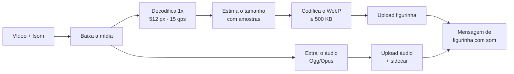

<p align="center">
  
</p>

<h1 align="center">Figurinhas com som para WhatsApp 🔊</h1>

<p align="center">
  <b>Bot de WhatsApp que transforma qualquer vídeo em figurinha animada com som.</b><br>
  Até de um <b>link do YouTube, TikTok ou Instagram</b>, começando no <b>segundo exato</b> que você quiser.<br>
  <i>WhatsApp sound sticker bot: turn any video (or YouTube/TikTok/Instagram link) into an animated sticker with audio. <a href="#english">English below</a>.</i>
</p>

<p align="center">
  <a href="https://github.com/coelhobugado/whatsapp-figurinhas-com-som/actions/workflows/test.yml"></a>
  <a href="LICENSE"></a>
  
  
  
</p>

---

<p align="center">
  <br>
  <sub>Figurinha de verdade, gerada pelo bot em 3,6 s com <code>!som 1:10-1:14</code>. 🔊 <a href="https://github.com/coelhobugado/whatsapp-figurinhas-com-som/raw/main/docs/exemplo-lhama.mp4"><b>Baixe o vídeo com som</b></a> (165 KB; o GitHub não toca som em imagens).<br>
  Cena do curta <a href="https://studio.blender.org/projects/caminandes/">Caminandes: Llama Drama</a> © Blender Foundation, <a href="https://creativecommons.org/licenses/by/3.0/">CC BY 3.0</a>.</sub>
</p>

## O que é

Mande um vídeo, ou só o link dele, com `!som`, e receba de volta uma **figurinha animada que toca o áudio**:

```
você:  !som 0:42 https://youtube.com/watch?v=…
bot:   ⏳ … 🔊  [figurinha animada do trecho 0:42–0:52, com som]
```

O bot roda no seu computador ou servidor, conectado a um número de WhatsApp como um "aparelho conectado". Qualquer pessoa (ou só quem você liberar) manda o vídeo ou o link para esse número e recebe a figurinha com áudio de volta, no privado ou em grupos.

> **E o WhatsApp oficial?** Em novembro de 2026 o WhatsApp começou a liberar, aos poucos e para poucas pessoas, a criação de figurinhas com som a partir de um vídeo da galeria. O bot funciona para **todo mundo, já**, e faz o que o app não faz: figurinha direto de **link** (sem baixar o vídeo), escolha do **trecho exato** de vídeos longos e uso **em grupo**, sem ninguém sair da conversa.

## Recursos

- 🔊 **Figurinha com som**: a partir de vídeo de celular, GIF ou vídeo mandado como documento.
- 🔗 **Direto do link**: YouTube, TikTok ou Instagram, sem baixar nada no celular.
- ⏱️ **Trecho exato**: `!som 0:42` ou `!som 0:42-0:47`, até de vídeos de horas (só o pedaço é baixado). Link do YouTube com tempo (`?t=42`) já começa no ponto certo.
- 🖱️ **Instalação de 1 clique** no Windows: instala o que falta e abre o QR no navegador.
- 🔄 **Atualiza sozinho**: confere o GitHub a cada 6 horas, instala a versão nova e reabre. Dá para desligar digitando `atualizar off` na janela do bot (ou `!atualizar off` pelo WhatsApp, para quem cuida do bot).
- ⚡ **Rápido**: ~3–8 s por figurinha, mesmo com vídeo 1080p pesado ([veja como](#como-ficou-rápido)).
- 🖼️ **Sem bordas pretas**: preenche o quadrado 512×512 cortando o centro, ou `inteiro` para manter a imagem toda com fundo transparente.
- 🏷️ **Nome do pacote personalizado** ("Criada por …") gravado na figurinha.
- 🛟 **Nunca deixa ninguém sem resposta**: se o som falhar, manda a versão sem som e explica o motivo. Todo erro volta numa frase curta com um código (ex.: `erro REDE · ref a1b2c3`) que quem cuida do bot consulta com `!erros`.
- 🧵 **Fila justa para grupos**: faz várias figurinhas ao mesmo tempo, reveza entre as conversas (um grupo agitado não trava o privado de ninguém) e mostra a espera com a reação 🕒, sem mensagens de "você é o 3º".
- 🛡️ **Anti-flood**: limite de pedidos por pessoa e por grupo, e ritmo seguro de envio para o número não ser bloqueado.
- ♻️ **Aguenta quedas**: se a internet cair, reconecta sozinho e responde o que chegou enquanto estava fora (até 3 h). Se o bot cair, reabre sozinho e retoma os pedidos que ficaram pela metade.
- 🔒 **Privado**: a conversão é local, com FFmpeg, e os vídeos não passam por serviços de conversão. Links são baixados da própria plataforma (no TikTok, uma das fontes de reserva usa o site SSSTik).
- 🙂 Também faz figurinhas comuns (sem som) de foto, vídeo e GIF.

## Comandos

| Comando | O que faz |
|---|---|
| `!som` (ou `!fs`) | Figurinha animada **com som**. Mande o vídeo com essa legenda ou responda a um vídeo com `!som`. |
| `!som <link>` | O mesmo, a partir de um link de **YouTube, TikTok ou Instagram**. |
| `!som 0:42 <link>` | Começa no **0:42** e usa até 10 s. `!som 0:42-0:47` usa só esse pedaço. Também vale com vídeo enviado. |
| `!fig` (ou `!f`, `!s`) | Figurinha comum, sem som, de foto, vídeo, GIF ou link (aceita o trecho também). |
| `!ajuda` | Lista os comandos. |
| `!atualizar` | **Só para quem cuida do bot** (não aparece para os outros). Confere se há versão nova e instala agora. `!atualizar off` / `on` desliga ou liga a [atualização automática](#atualização-automática). |

- Formatos de tempo aceitos: `42`, `42s`, `0:42`, `1:02:03`. No YouTube, o link de "Compartilhar › Começar em" (`?t=42`) já define o início.
- Também dá para **responder** a uma mensagem que tenha o link ou o vídeo com o comando.
- `!som inteiro` / `!fig inteiro`: mantém a imagem toda (bordas transparentes) em vez de cortar.
- Reações do bot: 🕒 na fila · ⏳ processando · 🔊 saiu com som · ✅ saiu sem som · ❌ erro.
- Limites: até **10 segundos** por figurinha; vídeo enviado de até **16 MB** (por link, vídeos maiores funcionam: só o trecho é baixado).

## Instalação

### Jeito fácil (1 clique)

**Windows**

1. Nesta página, clique em **Code › Download ZIP** e extraia a pasta.
2. Dê dois cliques em **`INICIAR-WINDOWS.bat`**.
   - Se o Windows avisar "O Windows protegeu o computador", clique em **Mais informações › Executar assim mesmo**.
3. Ele instala sozinho o que faltar (Node.js e FFmpeg, pelo `winget`), pergunta o nome que vai aparecer nas figurinhas e liga o bot.
4. O navegador abre com um **QR code**. No celular do bot: **WhatsApp › Configurações › Aparelhos conectados › Conectar um aparelho** e escaneie.

Nas próximas vezes, é só dar dois cliques no mesmo arquivo. Para desligar, feche a janela preta.

**macOS / Linux**

Baixe o ZIP (ou `git clone`), abra o Terminal na pasta e rode:

```bash
bash iniciar-mac-linux.sh
```

Ele confere Node.js e FFmpeg (instala pelo Homebrew ou `apt` quando dá), instala as dependências, cria o `.env` e liga o bot.

### Jeito manual (para desenvolvedores)

**Requisitos**

- [Node.js](https://nodejs.org) 22.12 ou mais novo
- [FFmpeg](https://ffmpeg.org) e ffprobe no PATH, com `libwebp`, `libopus` e `libx264` (o bot confere ao iniciar):
  - **Windows**: `winget install Gyan.FFmpeg` (ou o build "full" do [gyan.dev](https://www.gyan.dev/ffmpeg/builds/))
  - **Linux**: `sudo apt install ffmpeg`
  - **macOS**: `brew install ffmpeg`
- Um número de WhatsApp para o bot (de preferência separado do seu).

**Rodando**

```bash
git clone https://github.com/coelhobugado/whatsapp-figurinhas-com-som.git
cd whatsapp-figurinhas-com-som
npm install
cp .env.example .env      # no Windows: copy .env.example .env
npm start
```

Na primeira vez aparece um **QR** no terminal e também como imagem em **http://localhost:3999**. No celular do bot: **Configurações › Aparelhos conectados › Conectar um aparelho** e escaneie. A sessão fica salva em `sessao/`; nas próximas vezes o bot conecta sozinho.

Pronto: mande um vídeo com a legenda `!som` para o número do bot.

## Atualização automática

Toda vez que você abre o bot, antes de conectar no WhatsApp, ele confere se saiu versão nova no GitHub. Se saiu, instala, reabre sozinho e já começa na versão nova. Depois, com ele ligado, confere de novo a cada 6 horas: se sair versão nova, termina os pedidos em andamento, instala e reabre. Quando as dependências mudam, ele roda o `npm ci` sozinho. Tudo aparece na mesma janela do cmd/terminal:

```
Conferindo se há versão nova do bot...
Versão nova encontrada (2b89efa → f3ebf34). Terminando os pedidos em andamento...
Bot atualizado para f3ebf34 (1 mudança(s)).
Reabrindo o bot com a versão nova...
Conferindo se há versão nova do bot...
O bot já está na versão mais nova (f3ebf34).
Bot conectado.
``` A sessão do WhatsApp (`sessao/`) e o `.env` nunca são tocados.

- **Baixou pelo ZIP**: ele baixa o pacote da versão nova do GitHub e copia por cima. Se você mudou arquivos do código, desligue a atualização, senão as mudanças são substituídas.
- **Baixou com `git clone`**: ele faz `git pull` (só avança, `--ff-only`). Se você mudou arquivos do projeto ou tem commits que não estão no GitHub, ele não mexe em nada e só avisa no terminal.

Dá para controlar de dois jeitos:

- **Na janela do bot** (o cmd/terminal onde ele está rodando): digite o comando e aperte Enter.
- **Pelo WhatsApp**, só quem cuida do bot: o **próprio número do bot** (mandando no "conversar comigo mesmo" do celular do bot) e os números em `ADMIN_NUMBERS`. Para os outros usuários o comando não funciona e nem aparece no `!ajuda`.

| Na janela do bot | No WhatsApp | O que faz |
|---|---|---|
| `atualizar` | `!atualizar` | Confere e instala agora, mesmo com a automática desligada. |
| `atualizar off` | `!atualizar off` | Desliga a atualização automática (grava `AUTO_UPDATE=false` no `.env`). |
| `atualizar on` | `!atualizar on` | Liga de novo. |

Com a automática desligada, o bot continua conferindo e só **avisa na janela** quando sai versão nova ("digite atualizar aqui e aperte Enter").

> Quem instalou antes desta função precisa atualizar à mão **uma vez** (baixar o ZIP de novo, mantendo `sessao/` e `.env`, ou `git pull`). Depois disso ele se atualiza sozinho.

## A janela do bot

Ao abrir (e depois de cada atualização) a janela é limpa e mostra só o essencial, uma linha por acontecimento, com quem usou:

```
FIGURINHAS COM SOM  v9d39d37
──────────────────────────────────────────────
16:48  ● bot iniciado · ouvindo comandos
16:48  · +55 11 98765-4321 (Maria) usou !ajuda
16:49  ✓ +55 11 98765-4321 (Maria) usou !som  com som · 7,5 s
16:50  ✗ Amigos · +55 11 91234-5678 (Ana) usou !fig  TRECHO · ref 086009 · O vídeo tem só 0:18.
›
```

No `›` dá para digitar: `status` (conexão, fila, versão, contagem), `atualizar`, `atualizar off`/`on`, `erros`, `erros <ref>`, `limpar`, `ajuda` e `sair`. Os números de quem usou aparecem só na janela; o registro de erros em `dados/` não guarda telefones.

## Fila, anti-flood e quedas

**Fila.** O bot faz até 3 figurinhas ao mesmo tempo (1, 2 ou 3, conforme os núcleos do computador; ajuste em `MAX_PARALLEL`). A vez é sempre da conversa menos atendida: se um grupo manda 6 pedidos e alguém manda 1 no privado, o do privado passa na frente do resto do grupo. Quem está esperando recebe a reação 🕒, que vira ⏳ quando começa.

| Limite | Valor | Ao passar |
|---|---|---|
| Pedidos de uma pessoa na fila | 2 | "Você já tem pedidos na fila" |
| Pedidos de uma conversa na fila | 6 | "Já tem muitos pedidos desta conversa" |
| Pedidos na fila no total | 20 (`MAX_PENDING`) | "Estou com muitos pedidos agora" |
| Comandos por pessoa por minuto | 6 | "Calma, espere um minuto" |
| Comandos por grupo por minuto | 20 | "Muitos pedidos neste grupo" |
| Mensagens enviadas pelo bot por minuto | 60 (`MAX_MESSAGES_PER_MINUTE`) | as mensagens esperam a vez, nada se perde |

Cada aviso de limite sai no máximo uma vez a cada 2 minutos por pessoa ou grupo, para o próprio aviso não virar flood. Quem cuida do bot não entra nos limites por pessoa e por grupo.

**Quedas.**

- **Internet caiu:** reconecta sozinho (tenta de novo em 1 s, 2 s, 4 s… até 1 min entre tentativas, sem parar). Ao voltar, responde os pedidos mandados enquanto estava fora, de até 3 horas atrás (`MAX_MESSAGE_AGE_MINUTES`), com um "desculpe a demora".
- **O bot caiu** (erro inesperado, falta de memória): o inicializador reabre em 2 s, 4 s, 8 s… Se cair 5 vezes em 10 minutos, para e deixa o erro na tela.
- **Pedidos pela metade:** ficam salvos em `dados/pedidos.json` e são retomados quando o bot volta (de queda, atualização ou do computador desligado). Um pedido que derrubou o bot duas vezes é abandonado, com aviso, para não entrar num ciclo de quedas.
- **Computador reiniciou:** no Windows, dê dois cliques em **`LIGAR-COM-O-WINDOWS.bat`** e o bot liga sozinho (minimizado) ao entrar no Windows. Dois cliques de novo desfazem. No Linux, use um serviço (systemd) ou o `pm2`.

**Erros.** Toda falha vira uma resposta curta com o motivo, um código e uma referência:

> Não consegui baixar o arquivo do WhatsApp (ele pode ter expirado). Reenvie e tente de novo.
> _(erro WA-DOWNLOAD · ref 3f9a1c)_

Quem cuida do bot manda `!erros` para ver os últimos erros, ou `!erros 3f9a1c` para os detalhes técnicos de um (também dá para digitar `erros` na janela do bot). Tudo fica em `dados/erros.jsonl`, sem números de telefone nem conteúdo de mensagens.

| Código | O que houve |
|---|---|
| `TAMANHO`, `RESOLUCAO`, `TRECHO` | Arquivo grande demais, resolução acima de 4K, trecho fora do vídeo |
| `ARQUIVO-ILEGIVEL`, `ARQUIVO-VAZIO`, `SEM-VIDEO`, `SEM-IMAGEM` | Arquivo corrompido ou sem a mídia esperada |
| `LIMITE-500KB`, `LIMITE-100KB`, `ANIMACAO` | Não coube no limite do WhatsApp, ou o vídeo é parado demais |
| `AUDIO`, `SOM-RECUSADO` | Não deu para extrair o áudio, ou o WhatsApp recusou a versão com som (a figurinha sai sem som) |
| `LINK-BAIXAR`, `LINK-FOTOS`, `LINK-INVALIDO` | Problema com o link (privado, removido, post só de fotos) |
| `WA-DOWNLOAD` | Não conseguiu baixar a mídia do WhatsApp |
| `ENVIO`, `ENVIO-REDE` | A figurinha ficou pronta, mas o envio falhou |
| `REDE` | A internet falhou no meio |
| `DEMOROU`, `FFMPEG-TEMPO` | Passou do tempo máximo |
| `FFMPEG`, `FFMPEG-FALTA` | O conversor falhou, ou o FFmpeg não está instalado |
| `DISCO-CHEIO`, `MEMORIA` | Falta espaço ou memória no computador do bot |
| `TRAVOU` | O pedido derrubou o bot duas vezes e foi abandonado |
| `SESSAO-DESCONECTADA`, `SESSAO-DUPLICADA`, `NUMERO-BLOQUEADO` | Problemas de conexão que reabrir não resolve |
| `INTERNO` | Erro não previsto: veja os detalhes com `!erros <ref>` |

## Configuração (`.env`)

| Variável | Padrão | Para quê |
|---|---|---|
| `ALLOWED_NUMBERS` | vazio (todos) | Números que podem usar o bot (só dígitos, com DDI e DDD, separados por vírgula). Ex.: `5511999998888`. Número brasileiro sem o 55, ou com/sem o 9 da frente, também é reconhecido. |
| `ADMIN_NUMBERS` | vazio | Números de quem cuida do bot e pode usar o `!atualizar` (mesmo formato do `ALLOWED_NUMBERS`). O próprio número do bot sempre pode. |
| `AUTO_UPDATE` | `true` | `false` desliga a [atualização automática](#atualização-automática). O `!atualizar off`/`on` muda esse valor. |
| `STICKER_PACK_NAME` | `Criada por Dexter` | Nome que aparece ao tocar na figurinha. |
| `STICKER_PUBLISHER` | vazio | Autor mostrado ao lado do nome. |
| `AUTH_DIR` | `./sessao` | Onde a sessão do WhatsApp é salva. |
| `QR_PORT` | `3999` | Porta da página local do QR. |
| `MAX_PENDING` | `20` | Pedidos na fila no total (fazendo + esperando). |
| `MAX_PARALLEL` | automático | Figurinhas ao mesmo tempo (1, 2 ou 3 conforme os núcleos). |
| `MAX_MESSAGE_AGE_MINUTES` | `180` | Ao voltar de uma queda, responde pedidos de até tantos minutos atrás. |
| `MAX_MESSAGES_PER_MINUTE` | `60` | Ritmo máximo de mensagens enviadas pelo bot. |
| `DATA_DIR` | `./dados` | Pedidos pendentes e registro de erros (não compartilhe). |
| `FFMPEG_PATH`, `FFPROBE_PATH` | PATH | Caminho do FFmpeg, se não estiver no PATH. |
| `YTDLP_PATH` | PATH | `yt-dlp` opcional, usado como reserva se as bibliotecas JS falharem. |
| `DEBUG` | `false` | Mostra cada mensagem recebida e o tempo de cada etapa (sem conteúdo nem números). |
| `LOG_LEVEL` | `silent` | Logs internos do Baileys. |

## Como funciona



### Como ficou rápido

O que mais pesa é codificar o WebP animado (2–5 s por tentativa num vídeo pesado), e vídeo de celular raramente cabe em 500 KB na primeira qualidade. Em vez de tentar qualidade por qualidade, o bot:

1. **Decodifica o vídeo uma única vez** para um intermediário de 512 px a 15 quadros/s (só os primeiros 10 s), enquanto extrai o áudio em paralelo.
2. **Estima o tamanho** de cada degrau de qualidade com amostras de ~1,5 s (começo, meio e fim), em duas rodadas de amostras paralelas.
3. **Codifica uma vez**, direto no melhor degrau que deve caber. Se a estimativa errar, desce um degrau.

| Vídeo de teste | Ingênuo (tentativa por tentativa) | Este bot |
|---|---|---|
| 1080×1920, 12 s, muito movimento | ~22 s | **~7 s** |
| 720×1280, 4 s | — | **~3,5 s** |

Meça no seu computador com `npm run bench -- seu-video.mp4`.

O áudio sai em **Ogg/Opus mono 48 kHz**, o formato das mensagens de voz, que toca em todos os aparelhos. Leva um fade de 20 ms no começo e 120 ms no fim para não estalar quando a figurinha repete. Áudio totalmente mudo é detectado.

### A figurinha com som no protocolo

A figurinha e o áudio sobem como mídias separadas. O áudio recebe um `streamingSidecar` (HMAC-SHA256 de cada bloco de 64 KiB do arquivo cifrado, truncado em 10 bytes). A mensagem vai assim:

```
Message
 └─ 134 FutureProofMessage
      └─ 1 Message
           └─ 26 StickerMessage (WebP animado)
                └─ 26 AudioMessage (Ogg/Opus + streamingSidecar)
```

O campo 134 e o `StickerMessage.26` não existem no protobuf do [Baileys](https://github.com/WhiskeySockets/Baileys). O bot troca `proto.Message.encode` por uma versão que monta esses bytes só nas mensagens marcadas; todas as outras mensagens saem idênticas (há teste para isso). Detalhes em [`src/sound-sticker.ts`](src/sound-sticker.ts).

## Estrutura

| Arquivo | Papel |
|---|---|
| [`src/bot.ts`](src/bot.ts) | Conexão, comandos, fila, mensagens de erro |
| [`src/convert.ts`](src/convert.ts) | Vídeo → WebP animado + áudio, com a estimativa de tamanho |
| [`src/sound-sticker.ts`](src/sound-sticker.ts) | Monta e envia a figurinha com som |
| [`src/webp.ts`](src/webp.ts) | Lê o WebP e grava o nome do pacote (EXIF) |
| [`src/link-download.ts`](src/link-download.ts) | Baixa vídeos de TikTok/Instagram/YouTube pelo link, com fontes de reserva |
| [`src/commands.ts`](src/commands.ts) | Comandos e localização da mídia (inclusive citada) |
| [`src/queue.ts`](src/queue.ts) | Fila justa entre conversas, em paralelo, com limites e tempo máximo |
| [`src/limits.ts`](src/limits.ts) | Anti-flood: limite por pessoa/grupo e ritmo de envio |
| [`src/errors.ts`](src/errors.ts) | Reconhece cada erro, dá o código curto e guarda o registro (`!erros`) |
| [`src/pending.ts`](src/pending.ts) | Pedidos salvos em disco para retomar depois de uma queda |
| [`src/terminal.ts`](src/terminal.ts) | Visual da janela do bot: abertura, horário e etiquetas coloridas (OK, FIG, AVISO, ERRO…) |
| [`src/qr-page.ts`](src/qr-page.ts) | Página local com o QR de vinculação |
| [`src/updater.ts`](src/updater.ts) | Atualização automática (git ou pacote do GitHub) |
| [`scripts/iniciar-bot.mjs`](scripts/iniciar-bot.mjs) | Inicializador do `npm start`: reabre o bot depois de atualizar |

```bash
npm run converter -- video.mp4 [--inteiro] [--trecho 0:42-0:47]   # gera saida/video.webp e saida/video.ogg, sem WhatsApp
npm run bench -- video.mp4                   # mede o tempo de cada etapa
npm run check                                # tipos + testes (os testes usam o FFmpeg)
```

## Perguntas frequentes

**Como fazer figurinha com som no WhatsApp?**
Rode este bot, mande um vídeo (ou um link do YouTube, TikTok ou Instagram) para o número dele com `!som` e use a figurinha que voltar: dá para reencaminhá-la para outras conversas.

**O WhatsApp já não faz isso sozinho?**
Está começando: desde novembro de 2026 o WhatsApp libera aos poucos, para algumas pessoas, a criação de figurinha com som a partir de um vídeo da galeria. O bot funciona para todo mundo agora e faz o que o app não faz: figurinha direto de link, escolha do trecho exato de vídeos longos e uso em grupo.

**Como faço figurinha de um momento específico de um vídeo do YouTube?**
Mande `!som 1:23 <link>` (começa em 1:23 e usa até 10 s) ou `!som 1:23-1:28 <link>` (só esse pedaço). Ou, no YouTube, use **Compartilhar › Começar em** e mande o link com `!som`. Só o trecho é baixado, então funciona até com vídeos de horas.

**Funciona em grupo?**
Sim. Qualquer participante pode mandar `!som` com um vídeo ou respondendo a um vídeo do grupo (respeitando `ALLOWED_NUMBERS`, se configurado).

**Por que a figurinha chegou sem som?**
O bot responde com o motivo: o vídeo não tinha áudio, o áudio era mudo, ou o WhatsApp recusou a versão com som. Nesse caso ele manda a versão sem som para você não ficar sem nada.

**Posso usar no meu número pessoal?**
Pode, mas é mais seguro usar um número separado. Se usar o seu, os comandos que você digitar em qualquer conversa também serão atendidos.

**Precisa deixar o computador ligado?**
Sim, o bot precisa estar rodando para responder. Se ficar fora do ar por pouco tempo, ele responde ao voltar o que chegou nas últimas 3 horas. No Windows, o `LIGAR-COM-O-WINDOWS.bat` faz ele ligar sozinho com o computador. Para ficar 24 h, rode num servidor ou VPS (Node.js + FFmpeg).

## Solução de problemas

| Sintoma | O que fazer |
|---|---|
| "O FFmpeg instalado não tem o encoder…" | Instale um build completo do FFmpeg (veja Requisitos). |
| QR não aparece | Abra http://localhost:3999 no navegador. |
| O `INICIAR-WINDOWS.bat` diz que não achou o FFmpeg logo depois de instalar | Feche a janela e abra o arquivo de novo (o Windows só enxerga programas novos numa janela nova). |
| "Não entendi o tempo…" | Use `!som 0:42` ou `!som 0:42-0:47` (minutos:segundos). |
| Bot não responde | Rode com `DEBUG=true` e veja se as mensagens chegam; confira `ALLOWED_NUMBERS`. |
| Alguém recebeu "erro XYZ · ref abc123" | Mande `!erros abc123` ao bot (ou digite `erros abc123` na janela) para ver o detalhe técnico. |
| "O bot caiu 5 vezes em 10 minutos" | Leia o erro na tela (ou em `dados/erros.jsonl`), resolva e abra o bot de novo. |
| "Outra cópia do bot abriu esta mesma sessão" | Só pode haver um bot rodando por sessão. Feche o outro. |
| "O celular desconectou o bot" | Apague a pasta `sessao/` e escaneie o QR de novo. |
| "Atualização automática: há arquivos do bot modificados…" | Você mudou arquivos do projeto (instalação pelo git). Desfaça com `git checkout .` ou atualize à mão. |
| "Não consegui instalar as dependências novas" | Confira a internet e rode `npm install` na pasta do bot. |

## Avisos

- **Formato não oficial.** A estrutura da figurinha com som vem de engenharia reversa do aplicativo; uma atualização do WhatsApp pode fazê-la chegar sem som. O bot então manda a versão sem som.
- **Cliente não oficial.** O [Baileys](https://github.com/WhiskeySockets/Baileys) conecta como "aparelho conectado". Automação no WhatsApp pode levar ao bloqueio do número, principalmente com muitas mensagens ou respostas a desconhecidos. Use com moderação e por sua conta e risco. Este projeto não tem relação com o WhatsApp nem com a Meta.
- A pasta `sessao/` equivale a estar logado na conta. Ela está no `.gitignore`: **nunca publique**.

---

<a id="english"></a>

## English

**WhatsApp sound sticker bot.** Send a video with the caption `!som` and get back an **animated sticker that plays the video's audio**. Built with Node.js, TypeScript, [Baileys](https://github.com/WhiskeySockets/Baileys) and FFmpeg.

- Turns phone videos, GIFs, videos sent as documents and **YouTube/TikTok/Instagram links** into WhatsApp **stickers with sound** (audio stickers).
- Pick the exact moment: `!som 0:42 <link>` or `!som 0:42-0:47 <link>`; only that clip is downloaded, so it works with hour-long videos. YouTube `?t=` links start at that time.
- One-click setup on Windows (`INICIAR-WINDOWS.bat` installs Node.js and FFmpeg via winget and opens the QR code in the browser); `iniciar-mac-linux.sh` for macOS/Linux.
- Fast: ~3–8 s per sticker. The video is decoded once, the WebP quality level is picked by sampling, and the audio is extracted in parallel.
- Fills the 512×512 square (center crop) or keeps the whole frame with transparent borders (`!som inteiro`).
- Custom sticker pack name, per-user fair queue, friendly error messages, silent-audio detection, graceful fallback to a regular sticker.
- Self-updating: checks GitHub every 6 hours (`git pull --ff-only` for clones, release tarball for ZIP installs), then restarts itself. The bot owner can turn it off with `!atualizar off` (or `AUTO_UPDATE=false`).
- Conversion runs locally; no third-party conversion service. Links are fetched from the platforms themselves (one TikTok fallback uses SSSTik).

**Quick start:** install Node.js 22.12+ and FFmpeg (with libwebp, libopus, libx264), then:

```bash
npm install && cp .env.example .env && npm start
```

Scan the QR code (terminal or http://localhost:3999) from **Settings › Linked devices** on the bot's phone. Commands: `!som` (sticker with sound), `!fig` (regular sticker), `!ajuda` (help).

**How the sound sticker is sent:** the WebP and an Ogg/Opus voice-note-style audio are uploaded separately. The audio gets a `streamingSidecar`, and the message is wrapped as `Message.134 (FutureProofMessage) › Message.26 (StickerMessage) › StickerMessage.26 (AudioMessage)`. These fields are not in Baileys' protobuf, so the bot patches `proto.Message.encode` only for marked messages. The format was reverse engineered and may break with WhatsApp updates; this project is not affiliated with WhatsApp or Meta. Use at your own risk.

## Licença

[MIT](LICENSE) © 2026 Gabriel Fonseca Silva

Os arquivos de exemplo `docs/exemplo-lhama.webp` e `docs/exemplo-lhama.mp4` são um trecho de 4 s do curta [Caminandes: Llama Drama](https://studio.blender.org/projects/caminandes/) (Pablo Vazquez, Beorn Leonard e Francesco Siddi; música e som de Jan Morgenstern), © Blender Foundation, sob [CC BY 3.0](https://creativecommons.org/licenses/by/3.0/). Eles continuam sob essa licença, não sob a MIT.
